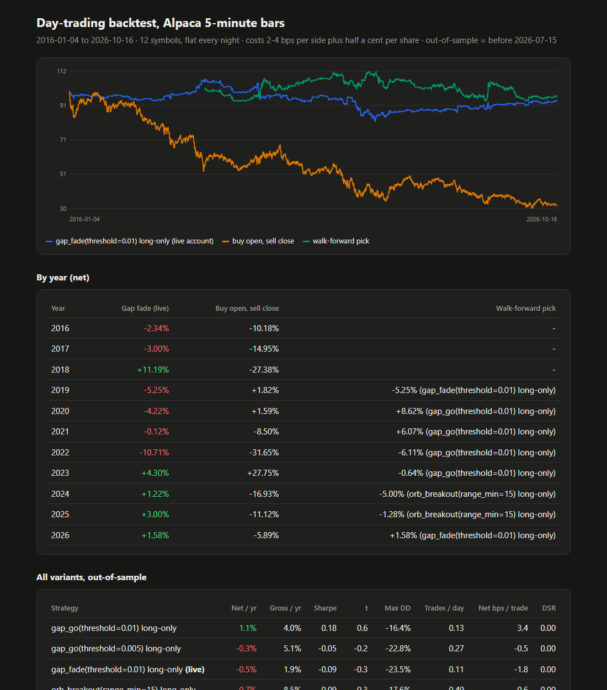
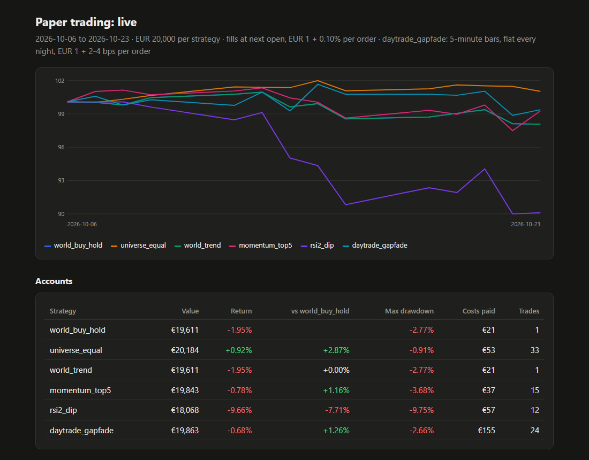

# Trading Strategy Backtests

> **Research project, not investment advice.** Nothing here recommends buying or selling anything. All trading
> in this repository is simulated (backtests and paper accounts with fake money).

Social media is full of "AI trading bots" with screenshots of huge returns. This project asks a simple question:
**do any of these strategies still make money once you test them honestly?** Honestly means trading costs, no
peeking at future data, results judged on data the strategy was never tuned on, and a statistical penalty for
trying many variants until one looks good.

It started by checking a widely shared open-source AI trading bot. Its own public demo lost more than its entire
simulated bankroll in four and a half days, mostly to the bid-ask spread. The project grew from there into a
small toolkit for testing strategies properly, and a live paper-trading setup to watch the survivors.

## What it found

| Test | Data | Result |
|---|---|---|
| **Look-ahead check** | BTC-USD daily, 2016-2026 | A strategy that secretly peeks at tomorrow's price shows a Sharpe ratio of 9.8 and more than +6,000%/yr. The harness flags it automatically. |
| **Classic signals** (moving-average crossover, momentum) | BTC-USD daily | Look great on the data they were tuned on (Sharpe ~1.3), fall below plain buy-and-hold in a walk-forward test, and fail the deflated Sharpe gate. |
| **Daily stock strategies** (trend filter, momentum top 5, RSI(2) dip buying) | 33 large caps + world ETF, 2018-2026 | Holding the same 33 stocks in equal weights did as well as the best strategy on a risk-adjusted basis. Trading costs cut the daily dip-buying strategy from 19.9% to 10.7% a year. |
| **Day trading**: 10 algorithms plus a baseline, 29 variants | 12 liquid US symbols, 5-minute bars, **2016-2026** (Alpaca SIP feed) | **None has an edge after costs.** The best out-of-sample variant makes +1.1%/yr (Sharpe 0.18, t = 0.6). The strategy picked from a 60-day sample, gap fade, makes -0.5%/yr over the ten years it never saw. |

The day-trading result in numbers (out-of-sample 2016-01-04 to 2026-07-14, 2,646 sessions, average of 12 symbols):

```
strategy                                net/yr gross/yr Sharpe     t   maxDD trd/d  bps gross>net
gap_go(threshold=0.01) long-only          1.1%     4.0%   0.18   0.6  -16.4%  0.13   12.0 >   3.4
gap_go(threshold=0.005) long-only        -0.3%     5.1%  -0.05  -0.2  -22.8%  0.27    7.6 >  -0.5
gap_fade(threshold=0.01) long-only       -0.5%     1.9%  -0.09  -0.3  -23.5%  0.11    6.6 >  -1.8
...
vwap_trend                             -121.6%    17.3%  -7.51 -24.3 -100.0%  7.44    0.9 >  -6.5

Walk-forward (re-pick the best variant every year from the 3 years before): net -0.1%/yr, Sharpe -0.02
```

Most day-trading signals have a small positive gross edge per trade (a few basis points). A round trip costs
about 4-8 basis points, so the edge is gone after costs. The more often a strategy trades, the worse it does.



## Features

- **Backtest harness** (`src/harness/`): vectorised single-asset backtests with a strict one-bar delay, per-trade
  costs, an automatic look-ahead detector (recomputes signals on truncated data), walk-forward parameter selection,
  and the probabilistic and deflated Sharpe ratios (Bailey & Lopez de Prado).
- **Paper-trading engine** (`src/papertrade/`): decide at the close, fill at the next open, EUR-denominated accounts
  with flat fee plus spread. One engine for both history replays and live forward trading, so the two cannot drift
  apart. A daily scheduled run updates every account and renders a self-contained HTML dashboard.
- **Intraday simulator** (`src/daytrade/`): 5-minute bars, stops and targets checked inside each bar (the stop wins if
  both are touched), always flat by the close, per-session costs with a half-cent spread floor. Every strategy is
  checked for look-ahead by hiding the rest of the session.
- **Data loaders**: Yahoo Finance (daily, 5-minute, hourly), Coinbase (crypto daily) and Alpaca (full-market SIP
  5-minute bars since 2016) through their REST APIs with plain `urllib`, cached locally. Handles DST, half-day
  sessions, dividend and split adjustment, data outages, and checks that two sources agree bar for bar.
- **Strategies**: buy-and-hold and equal-weight benchmarks, trend filter, cross-sectional momentum, RSI(2) mean
  reversion, and 10 intraday algorithms (two opening-range breakouts, VWAP trend, intraday momentum, gap fade and gap
  continuation, Bollinger, RSI, EMA crossover, Donchian) plus a buy-the-open, sell-the-close baseline.
- **Tests**: 35 `unittest` cases, all offline, including tests that the look-ahead detectors catch a cheating strategy.



## Tech stack

Python 3.10+, pandas, NumPy, pyarrow (Parquet cache), standard-library `urllib` for every API, `unittest`,
self-contained HTML reports with inline SVG charts. No trading SDKs, no frameworks.

## Getting started

```bash
python -m venv .venv
.venv\Scripts\activate          # Windows; on macOS/Linux: source .venv/bin/activate
pip install -r requirements.txt
python -m unittest discover tests
```

Run the experiments (market data is downloaded on first use and cached under `data/`):

```bash
# Single-asset harness on BTC-USD; try --strategy cheater to watch the look-ahead check fail it
python scripts/run_harness.py --strategy sma_cross

# Replay the daily stock strategies since 2018, then start live paper accounts and update them
python scripts/paper_trade.py backtest --start 2018-01-01
python scripts/paper_trade.py init
python scripts/paper_trade.py run          # run once per trading day, after the US close

# Day-trading backtest on Yahoo's last 60 days of 5-minute bars and ~3 years of hourly bars
python scripts/daytrade_backtest.py

# Ten-year day-trading backtest: needs free Alpaca paper-trading API keys
cp .env.example .env                       # Windows: copy; then fill in your keys
python scripts/daytrade_longrun.py
```

Reports are written as HTML files under `data/`.

## Caveats

- **Survivorship bias.** The stock lists are today's large caps, chosen with hindsight. Long strategies look better
  on them than they would have in real time, so stock strategies are judged against an equal-weight portfolio of
  the same list, not just against the market.
- **Optimistic fills.** Targets fill as soon as the price touches them and exits use the last 5-minute bar, not the
  closing auction. Real results would be slightly worse, which only strengthens the conclusion.
- **Data.** Market data is fetched at runtime from Yahoo Finance, Coinbase and Alpaca and is not included in this
  repository. Their terms of use apply.

## License

[MIT](LICENSE)
